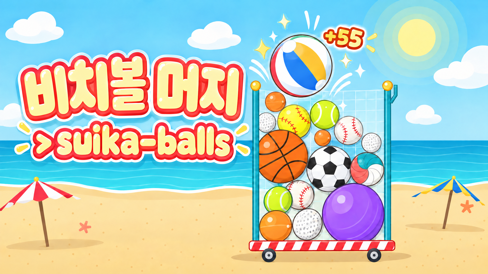

<p align="center">
   suika-balls" width="100%">
</p>

# suika-balls — 비치볼 머지

🏓 → ⛳ → 🎾 → ⚾ → 🏐 → ⚽ → 🏀 → 🏖️ Drop, bounce, and merge sports balls until you build the biggest one of all.

수박게임처럼 위에서 공을 떨어뜨리고, **같은 공 2개가 닿으면 한 단계 더 큰 공**으로 합쳐지는 2D 물리 퍼즐 웹게임입니다. 해변 테마, 스포츠 공 10종, 최종 목표는 비치볼. Godot 4.7 웹 빌드로 모바일·PC 브라우저에서 설치 없이 플레이합니다.

**언어: 한국어 / English** — 처음엔 브라우저 언어(한국어면 한국어, 그 밖엔 영어)를 따르고, 시작 화면 왼쪽 위 버튼이나 일시정지 메뉴에서 바꾸면 선택이 저장됩니다.

## Arcade로 돌아가기

웹 페이지 최상단의 `← Arcade` 링크는 `https://www.lucasflatwhite.com/arcade/`로 이동합니다. 게임과 독립된 HTML 상단 바로 제공하므로 로딩·실행 오류·일시정지·게임 종료·화면 회전 안내 중에도 사용할 수 있습니다. 모바일 전체 화면은 페이지 전체를 대상으로 하여 상단 바를 유지합니다.

상단 바 스타일은 `ui/web/arcade.css`, 화면 높이 연동은 `ui/mobile/runtime.js`, HTML 생성은 `tools/prepare_web.py`에서 관리합니다. 수정 후 `python3 tools/build_web_shell.py`로 `ui/web/shell.html`을 재생성합니다. 분석 스크립트와 외부 런타임 연결은 사용하지 않습니다.

```sh
python3 tests/test_arcade_navigation.py
node tests/test_mobile_shell.js
python3 tests/test_prepare_web_loader.py
python3 tests/test_standalone_web.py
python3 tests/test_version_web.py
```

## 독립 빌드와 캐시

Godot 4.7.2와 Web export template을 설치한 뒤 `npm run build`로 `dist/`를 생성합니다. `godot`이 PATH에 없으면 `GODOT_BIN`으로 실행 파일을 지정할 수 있습니다. `npm run verify`는 현재 게임 규칙·언어·재시작과 웹 셸 회귀 검사를 실행합니다. `npm run dev`는 빌드된 게임을 로컬에서 제공합니다.

아이콘·이펙트의 불필요한 다시 그리기와 2인 모드의 보드 직렬화도 회귀 검사에 포함됩니다. 측정 방법과 변경 전후 결과는 [성능 분석](docs/performance.md)에 정리했습니다.

웹 내보내기 후 `tools/prepare_web.py --directory dist`가 로딩 화면과 복귀 바를 만들고 `tools/version_web.py`를 통해 JS/WASM/PCK와 보조 파일을 `releases/<콘텐츠 해시>/`에 복사합니다. 진입 HTML은 새 버전을 확인하고, 해시 경로의 에셋에만 `max-age=31536000, immutable`을 적용합니다. 게임을 수정하면 경로도 바뀌므로 새 코드와 오래된 팩이 섞이지 않습니다. 기존 Vercel의 Godot 내보내기 → `prepare_web.py` 후처리 구성에도 동일하게 적용됩니다. 실제 파일은 Vercel의 파일 시스템에서 바로 제공하며, 없는 `releases/` 파일만 `api/release-not-found.js`로 보내 브라우저와 CDN에 `no-store`인 404를 반환합니다. 이 함수는 게임 팩에서 제외됩니다.

## 공 10단계

| 단계 | 공 | English | 지름(용기 폭 대비) | 합체 점수 |
|---|---|---|---|---|
| 1 | 탁구공 | Ping Pong Ball | 8% | 1 |
| 2 | 골프공 | Golf Ball | 10% | 3 |
| 3 | 테니스공 | Tennis Ball | 13% | 6 |
| 4 | 야구공 | Baseball | 16% | 10 |
| 5 | 소프트볼 | Softball | 20% | 15 |
| 6 | 배구공 | Volleyball | 25% | 21 |
| 7 | 축구공 | Soccer Ball | 30% | 28 |
| 8 | 농구공 | Basketball | 36% | 36 |
| 9 | 짐볼 | Gym Ball | 44% | 45 |
| 10 | 비치볼 | Beach Ball | 54% | 55 |

이름·크기·점수·반발력·밀도·마찰·색은 모두 [`data/balls.gd`](data/balls.gd) 한 파일에서 수정합니다.

## 규칙

- 떨어뜨릴 공은 1~5단계 중 무작위(작은 공이 더 자주).
- 같은 단계 공 2개가 닿으면 중간 지점에 다음 단계 공이 생깁니다. 연쇄 합체 가능.
- 비치볼 2개가 합쳐지면 둘 다 사라지고 **+100 보너스**.
- 공이 데드라인(주황 점선) 위에 2초 넘게 머물면 게임 오버. 떨어뜨린 지 1초 안 된 공은 제외.
- 최고 점수는 브라우저에 저장됩니다.

## 조작

- **PC**: 마우스로 조준, 클릭으로 떨어뜨리기 · ←/→ 이동, Space 떨어뜨리기 · P 일시정지 · M 소리
- **모바일**: 좌우로 드래그해 조준, 손을 떼면 떨어집니다.
- 같은 기기 **2인 분할 화면 대전** 모드 지원.

## 구현 메모

- 공·용기(볼 카트)·해변 배경은 이미지 없이 코드로 그립니다(`scripts/ball_art.gd`, `scripts/vfx/cart_art.gd`, `scripts/ui/beach_background.gd`).
- 효과음은 파일 없이 실시간 합성합니다(`scripts/game_audio.gd`).
- 문구: `localization/ko.json`, `localization/en.json` (키·자리표시자 일치는 `tests/test_ball_i18n.gd`로 검사).
- 한글 글꼴: [Jua](https://fonts.google.com/specimen/Jua) (SIL OFL) 부분 글꼴. 문구를 바꾸면 `tools/subset_korean_font.sh`로 다시 만듭니다.

## 실행·테스트

```sh
# 규칙 자동 테스트 (Godot 4.7)
godot --headless --audio-driver Dummy --fixed-fps 60 --path . --script tests/test_ball_rules.gd
godot --headless --audio-driver Dummy --fixed-fps 60 --path . --script tests/test_ball_i18n.gd
godot --headless --audio-driver Dummy --fixed-fps 60 --path . --script tests/test_restart_score.gd
# 웹 내보내기
npm run build
```

원본 제작은 Manus GameDev 퍼즐 스타터(Mushies)에서 출발했습니다. 현재 실행 코드에는 해당 플랫폼의 분석·미리보기·런타임 의존성이 없습니다. 원본 에셋 출처 기록과 글꼴·엔진 라이선스는 보존합니다.
